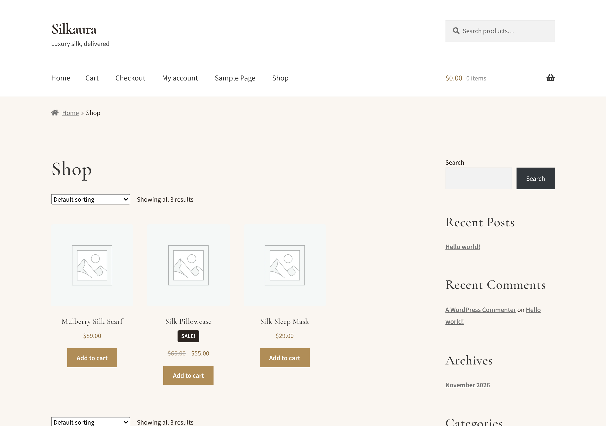

# Silkaura — WordPress + WooCommerce

Local development stack for the Silkaura store, built on Docker.

| Service    | URL                          | Notes                                  |
|------------|------------------------------|----------------------------------------|
| WordPress  | http://localhost:8080        | Admin at `/wp-admin`                   |
| Mailpit    | http://localhost:8025        | Catches all outgoing store emails      |
| phpMyAdmin | http://localhost:8081        | Optional: `make pma`                   |



## Run it on your computer

There are two ways: **XAMPP** (if you already use it) or **Docker**.

### Option A: XAMPP

1. Install [XAMPP](https://www.apachefriends.org/) with PHP 8.1 or newer.
2. Open the XAMPP Control Panel and click **Start** next to **Apache** and **MySQL**.
3. Download this repo (`git clone`, or *Code → Download ZIP* on GitHub and unzip it).
4. Run the installer from the repo folder:
   - **Windows:** double-click `install-xampp.cmd`
     (or in PowerShell: `powershell -ExecutionPolicy Bypass -File scripts\xampp-install.ps1`)
   - **Mac / Linux:** `bash scripts/xampp-install.sh`
     (on Linux, use `sudo` if your XAMPP lives in `/opt/lampp` and is owned by root)
5. Open **http://localhost/silkaura**. Admin is at http://localhost/silkaura/wp-admin
   with user `admin` / password `admin123`. Change the password in *Users → Profile*.

The installer downloads WordPress into `htdocs/silkaura`, creates a `silkaura`
database, installs WooCommerce and Storefront, and links the Silkaura theme from
this repo, so edits to the theme files in the repo show up on the site right away.
It's safe to run again.

You can keep the repo anywhere (e.g. `Documents\Silkaura`) or put it straight in
`htdocs\silkaura`. Both work; in the second case WordPress is installed around the
repo files, and `.gitignore` keeps WordPress's own files out of git.

Options (Windows: `-AdminPassword secret -Port 8080`; Mac/Linux: `ADMIN_PASSWORD=secret PORT=8080 bash ...`):
`Site`, `DbName`, `DbUser`, `DbPassword`, `Port`, `AdminUser`, `AdminPassword`, `AdminEmail`, `XamppDir`.
Set `Port` if Apache isn't on port 80 (common on Windows when Skype or IIS takes it).

To start over, delete `htdocs/silkaura` and drop the `silkaura` database in phpMyAdmin
(http://localhost/phpmyadmin).

### Option B: Docker

#### 1. Install Docker
- **Mac / Windows:** install [Docker Desktop](https://www.docker.com/products/docker-desktop/) and open it once
  so it's running (whale icon in the menu bar / system tray).
  On Windows, accept the WSL 2 prompt if Docker Desktop asks for it.
- **Linux:** install Docker Engine and the Compose plugin from your distro or docs.docker.com.

Check it works: `docker compose version`

#### 2. Get the code
```bash
git clone https://github.com/zelostek-creator/Silkaura.git
cd Silkaura
git checkout claude/serene-sagan-7q8qxp   # until this is merged into main
```

#### 3. Install the store
**Mac / Linux** (has `make`):
```bash
cp .env.example .env      # then edit .env: set WP_ADMIN_PASSWORD
make install
```

**Windows** (PowerShell, no `make` needed):
```powershell
copy .env.example .env    # then edit .env: set WP_ADMIN_PASSWORD
docker compose up -d
docker compose run --rm --entrypoint sh wpcli /scripts/install.sh
```

First run downloads ~1 GB of images and takes a few minutes. When it prints
`Silkaura store ready`, open http://localhost:8080 and log in at
http://localhost:8080/wp-admin with the user/password from `.env`.

> Port 8080 already in use? Change `WP_PORT` and `WP_URL` in `.env` before installing.

#### Stopping and starting
Your data is kept in Docker volumes between runs.
- Stop: `make down` (Windows: `docker compose down`)
- Start again: `make up` (Windows: `docker compose up -d`)
- Wipe everything and start fresh: `make reset` (Windows: `docker compose down -v`)
`make install` is idempotent. It:
1. Starts MariaDB, WordPress 7 (PHP 8.3) and Mailpit
2. Installs WordPress core
3. Installs and activates **WooCommerce** and the **Storefront** parent theme
4. Activates the **Silkaura** child theme
5. Sets pretty permalinks, store country/currency, skips onboarding
6. Creates Shop / Cart / Checkout / My Account pages
7. Enables Cash on Delivery and Bank Transfer for test orders
8. Seeds 3 sample silk products

## Everyday commands
```bash
make up                         # start
make down                       # stop
make logs                       # tail WordPress logs
make wp ARGS="plugin list"      # any WP-CLI command
make wp ARGS="wc product list --user=admin"
make reset                      # stop and DELETE all data
```
Without `make`, the equivalent of `make wp ARGS="plugin list"` is
`docker compose run --rm wpcli plugin list`.

## Testing orders
Cash on Delivery is enabled, so you can place an order at checkout without a card.
With Docker, order emails (customer + admin) show up in Mailpit at http://localhost:8025.
XAMPP doesn't send email out of the box; orders still work, the emails just aren't delivered.

## What's in the repo
```
docker-compose.yml               # db, wordpress, wpcli, phpmyadmin, mailpit
.env.example                     # configuration (copy to .env)
config/uploads.ini               # PHP limits (64M uploads, 512M memory)
scripts/provision.php            # Shared setup: WooCommerce, Storefront, theme, store settings
scripts/setup-store.php          # Store settings, pages and sample products
scripts/install.sh               # Docker installer
scripts/xampp-install.ps1        # XAMPP installer (Windows); install-xampp.cmd runs it
scripts/xampp-install.sh         # XAMPP installer (Mac / Linux)
wp-content/themes/silkaura/      # Storefront child theme (your code lives here)
  woocommerce/                   # WooCommerce template overrides
wp-content/mu-plugins/           # Must-use plugins (local mail → Mailpit)
```
WordPress core and third-party plugins live in a Docker volume and are **not**
committed. Only the custom theme and mu-plugins are version-controlled.

## Going to production
- Use strong, unique values for every password in `.env`; set `WP_DEBUG=0`.
- Configure a real payment gateway (e.g. WooCommerce Payments, Stripe, PayPal)
  and disable COD/BACS if not needed.
- Set up real SMTP (the Mailpit mu-plugin only runs when `WP_ENVIRONMENT_TYPE=local`).
- Put the site behind HTTPS and update `WP_URL` / Site Address.
